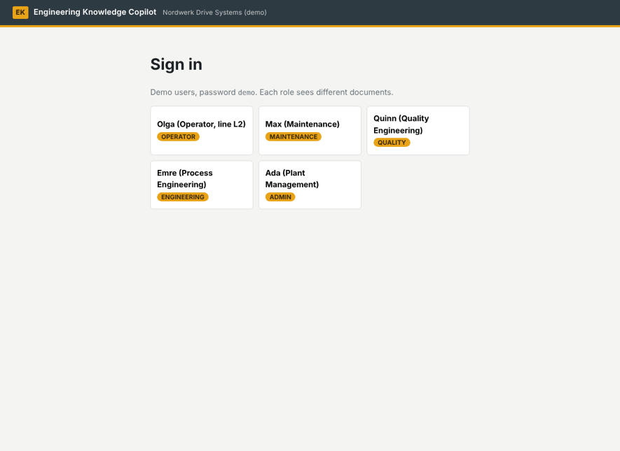
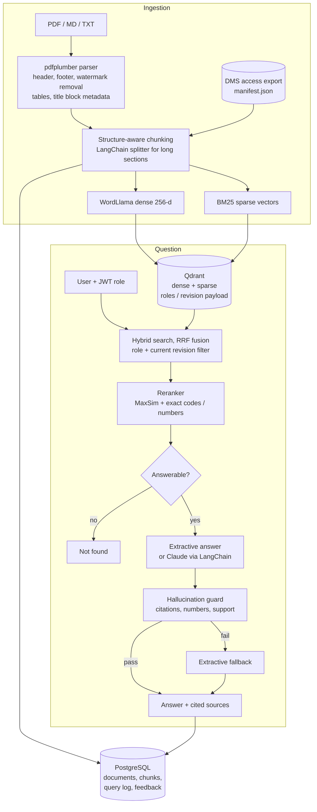
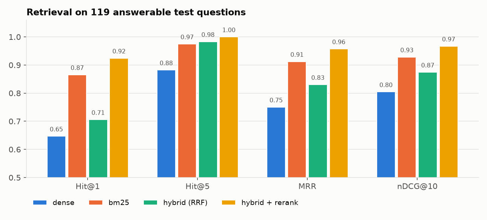
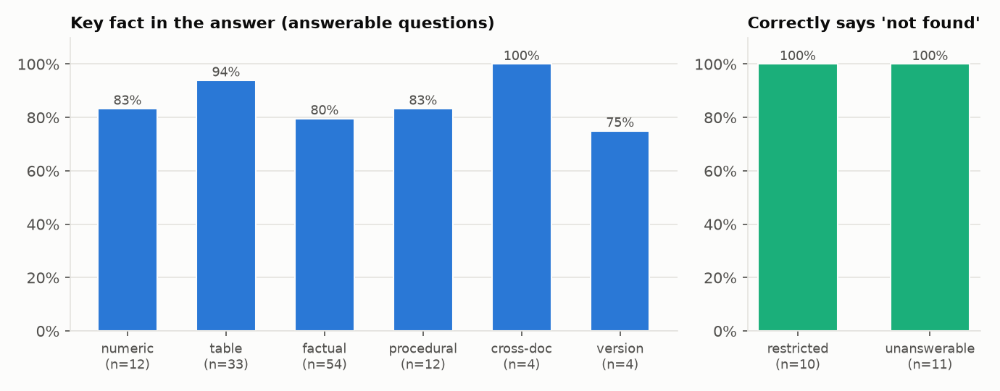
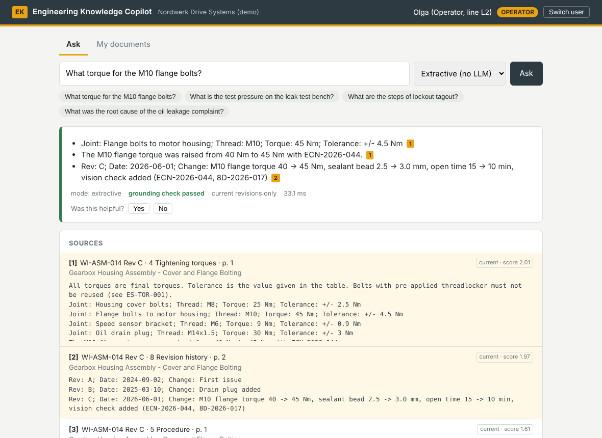
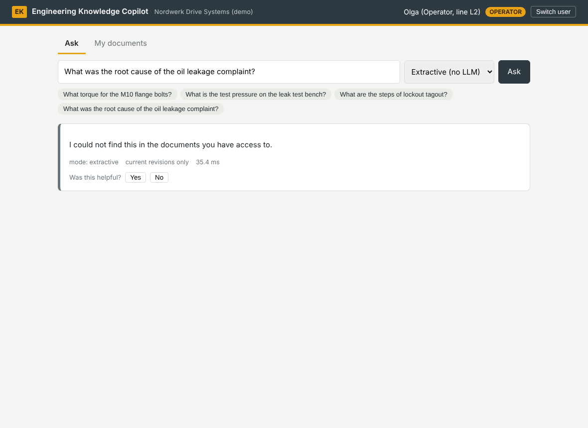
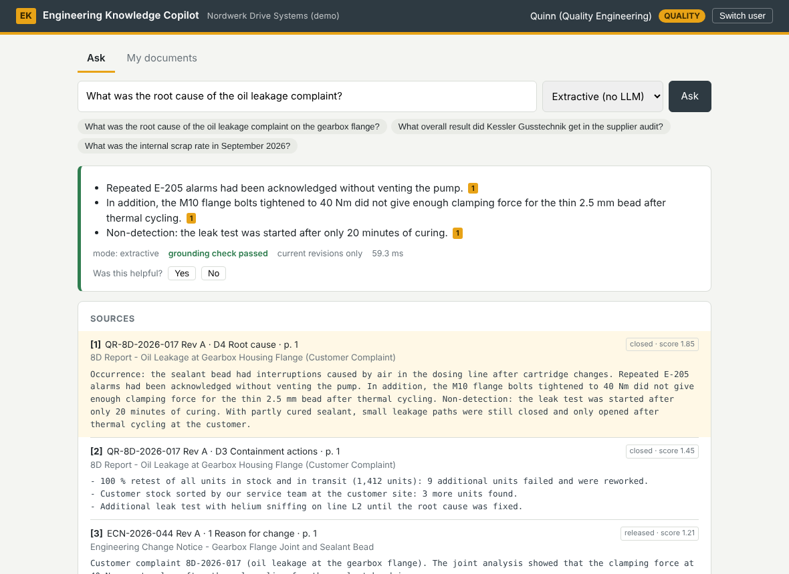
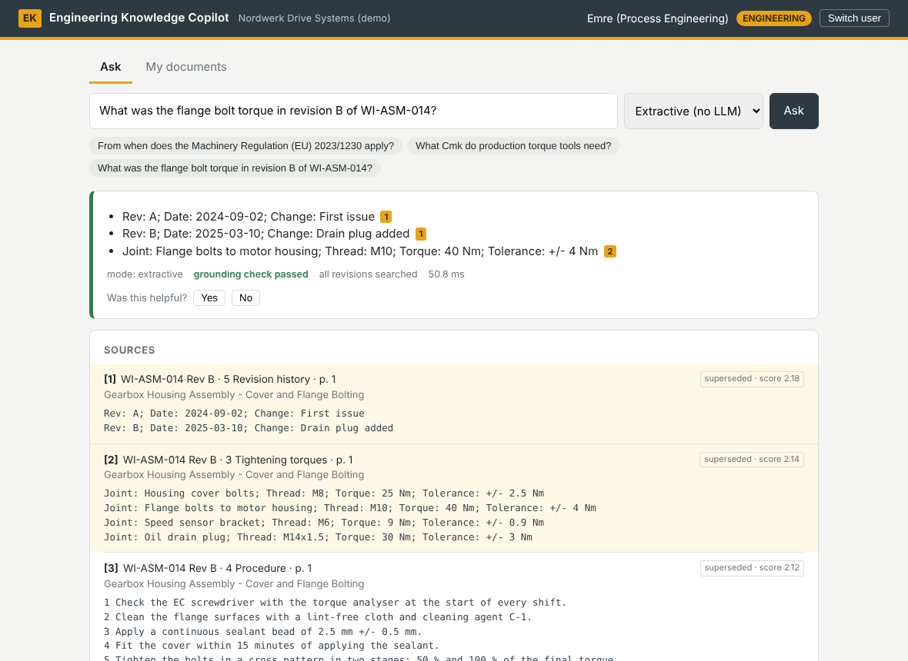

# Engineering Knowledge Copilot

A question-answering assistant for plant documents: work instructions, maintenance manuals, quality reports, engineering standards and regulation summaries. You ask "what torque for the M10 flange bolts?" and it answers from the current revision of the right document, with a citation to the page and section. It also knows what you are not allowed to see, and it says "not found" instead of guessing.



## The problem

On a shop floor the answer to most questions is written down somewhere, but often in a PDF three folders deep, in revision C while revision B is still printed at the station, or in an 8D report that the person asking isn't allowed to open. People ask a colleague instead, and the colleague remembers the old value.

A generic chatbot over those PDFs makes this worse in three specific ways, and I built the project around them:

1. **Wrong revision.** The old work instruction says 40 Nm and the current one says 45 Nm, and both are in the index. The copilot has to give the current value unless you explicitly ask about the old one.
2. **Access leaks.** An operator must not get the root cause from a confidential customer complaint just because it is the best-matching chunk. Hiding it in the UI isn't enough; it must never leave the database.
3. **Made-up numbers.** An answer with a wrong torque, pressure or limit is worse than no answer. Every number in an answer has to be traceable to the source it cites.

## Architecture



(Also as an image: [assets/architecture.png](assets/architecture.png).)

| Part | What I used | Where |
|---|---|---|
| Parsing | pdfplumber: text lines with font info, tables, watermark and margin filtering | `src/copilot/parsing.py` |
| Chunking | one chunk per section, LangChain `RecursiveCharacterTextSplitter` for long ones, tables split by rows with headers kept | `chunking.py` |
| Dense vectors | WordLlama `l2_supercat` (256-d, MIT); the weights ship with the pip package, so it runs offline on CPU | `embeddings.py` |
| Keyword search | BM25 as Qdrant sparse vectors (IDF computed by Qdrant) | `sparse.py` |
| Vector store | Qdrant: named dense + sparse vectors, RRF fusion, payload filters for role and revision | `store.py` |
| Reranking | word-level MaxSim (ColBERT-style) + exact matching of codes and numbers + phrase and question-type features | `rerank.py` |
| Answering | extractive (default, no LLM) or Claude through LangChain | `generation.py` |
| Guard | citation check, number grounding, word support per claim | `guard.py` |
| Access | demo users with roles, JWT, ACL per document revision | `access.py`, `configs/` |
| Database | PostgreSQL (SQLite for tests) via SQLAlchemy: documents, chunks, query log, feedback | `db.py` |
| API + UI | FastAPI, plain HTML/JS front end | `api.py`, `web/` |

## Dataset and licensing

The 23 documents belong to a **fictional** e-drive manufacturer, "Nordwerk Drive Systems GmbH". I wrote them myself, because real work instructions and 8D reports are confidential everywhere and public sample PDFs don't have the hard parts: several revisions of the same instruction, access levels, tolerance tables, and documents that refer to each other. The markdown sources are rendered into PDFs that look like DMS printouts, with headers, *Page x of y* footers, title blocks, wrapped table cells and SUPERSEDED / CONFIDENTIAL stamps. Those PDFs are what the copilot ingests.

The regulatory register refers to real EU regulations (Machinery Regulation 2023/1230, the noise directive 2003/10/EC, REACH, IATF 16949). I kept those parts to facts I could check. They are short summaries, not legal text.

Details on documents, roles and the question format are in [data/README.md](data/README.md). Code, documents and questions are under the MIT licence.

| | |
|---|---|
| Documents | 23 PDFs (6 work instructions, 4 maintenance, 6 quality, 3 engineering, 3 HSE/regulatory, 1 management) |
| Chunks | 138 |
| Roles | operator, maintenance, quality, engineering, admin |
| Eval questions | 140 test + 48 dev, written by hand, with gold sections and key facts |

## Running it

**Docker (Qdrant + PostgreSQL + API):**

```bash
docker compose up --build
# open http://localhost:8000 and pick a demo user (password: demo)
```

On first start the API sees an empty collection and ingests `data/corpus`. To use the LLM mode, put `ANTHROPIC_API_KEY=...` in a `.env` file next to `docker-compose.yml`. Set `COPILOT_ANSWER_MODE=llm` there if you want it as the default.

**Local, without Docker:**

```bash
python -m venv .venv && source .venv/bin/activate
pip install -r requirements-dev.txt && pip install -e .
uvicorn copilot.api:app --reload        # embedded Qdrant in .qdrant/, SQLite copilot.db
```

**Other commands:**

```bash
pytest                                   # 48 tests, about 20 s
python scripts/evaluate.py               # full offline evaluation -> reports/metrics.json
python scripts/evaluate.py --calibrate   # re-pick the abstention threshold on the dev set
python scripts/ingest.py --dir my_pdfs   # ingest your own folder
python scripts/build_corpus.py           # re-render the PDFs after editing data/source
python scripts/figures.py                # charts in assets/
```

**API, the short version:**

```bash
TOKEN=$(curl -s -X POST localhost:8000/auth/token -d "username=olga.operator&password=demo" | jq -r .access_token)
curl -s -X POST localhost:8000/ask -H "Authorization: Bearer $TOKEN" -H "Content-Type: application/json" \
     -d '{"question": "What is the test pressure on the leak test bench?"}' | jq .answer
```

| Endpoint | |
|---|---|
| `POST /auth/token` | log in, get a JWT |
| `POST /ask` | answer with sources, guard report, timings (`mode`: `extractive` or `llm`) |
| `POST /search` | retrieval only, with score breakdown (useful for debugging) |
| `GET /documents` | documents visible to your role |
| `POST /documents` | upload a PDF/MD/TXT with optional roles (admin only) |
| `POST /feedback` | thumbs up/down on an answer |
| `GET /stats` | query and feedback counts (admin only) |

Interactive docs are at `/docs`.

## How it works

**Parsing.** pdfplumber gives text lines with font size and weight. Characters bigger than 30 pt are watermark stamps and get dropped. So do lines in the top and bottom page margins and lines that repeat on most pages. Headings are recognised as bold, at least 11 pt and numbered ("4 Tightening torques", "D4 Root cause"). Tables are pulled out separately and written as one line per row with the column name in front of every value: `Joint: Flange bolts to motor housing; Thread: M10; Torque: 45 Nm; Tolerance: +/- 4.5 Nm`. That way a row still makes sense when it ends up alone in a chunk. Document number, revision, status and effective date come from the title block on page 1.

**Chunking.** Sections are the natural unit in these documents, so each section becomes a chunk unless it is longer than 1,100 characters. Every chunk gets a context line (`WI-ASM-014 Rev C - Gearbox Housing Assembly > 4 Tightening torques`) that is embedded and indexed with it.

**Revisions and access.** Every chunk carries `roles` and `is_current` in its Qdrant payload. Both filters run inside each prefetch of the hybrid query, so restricted chunks never come back from the database. When a newer revision is ingested, the older ones are flipped to `is_current: false`. Superseded revisions are only searched if the question asks for them ("in revision B", "before the change", "the old value").

**Hybrid retrieval.** Dense (WordLlama) and sparse (BM25) candidates, 30 each, are fused with reciprocal rank fusion in Qdrant.

**Reranking.** I couldn't download a cross-encoder in my build environment, and I didn't want one that needs a GPU anyway. So the reranker is a word-level late-interaction score (MaxSim over WordLlama word vectors) plus a few signals that matter in this domain:

- exact matches of codes and numbers from the question (E-205, M10, 0.5)
- a penalty when a code in the question is nowhere in the document (E-999 should not match E-101)
- phrase overlap ("test pressure")
- a small boost for step lists when the question asks "how do I…"
- a small boost for cause sections when it asks "why…"

**Answering.** The default answerer is extractive. It picks the sentences or table rows that best match the question from the top chunks and cites them. A procedure question gets the whole step list in order. It can't invent anything, which makes it a safe baseline and something I can evaluate offline. The LLM mode sends the top 5 numbered chunks to Claude with instructions to cite every sentence, copy numbers exactly and reply NOT_FOUND when the sources don't cover the question.

**Hallucination guard.** Every answer is checked before it goes out:

1. Every `[n]` must point to a source that was actually given.
2. Every claim needs a citation.
3. Every number in a claim must appear in the sources it cites.
4. Most content words of a claim must appear in its sources.

If an LLM answer fails, the user gets the extractive answer instead and the query log records the fallback.

**Knowing when to say no.** If the best chunk's answerability score is below 0.80, the answer is "I could not find this in the documents you have access to." I chose the threshold on the dev set, not the test set. A user asking about a restricted document gets the same sentence as for a question that isn't covered at all, so the copilot doesn't reveal that the document exists.

## Evaluation

Full write-up: [reports/evaluation.md](reports/evaluation.md). Everything below is the offline extractive mode on the 140 test questions.



| Retrieval (119 answerable questions) | Hit@1 | Hit@5 | MRR | nDCG@10 |
|---|---|---|---|---|
| Dense only | 0.647 | 0.882 | 0.750 | 0.805 |
| BM25 only | 0.866 | 0.975 | 0.912 | 0.928 |
| Hybrid (RRF) | 0.706 | 0.983 | 0.831 | 0.875 |
| **Hybrid + rerank** | **0.924** | **1.000** | **0.957** | **0.967** |

| Answers | Result |
|---|---|
| Answerable questions answered | 88.2 % |
| Key fact correct when it answers | 96.2 % |
| Citation precision | 95.1 % |
| Superseded value given as the answer | 0 of 140 |
| Restricted questions refused | 10 / 10 |
| Questions not covered by the documents refused | 11 / 11 |
| Chunks returned outside the user's role (all questions, all set-ups) | 0 |
| Latency p50 / p95, full pipeline on CPU | 21 ms / 37 ms |



The left chart counts a refusal on an answerable question as a miss.

Two things surprised me. BM25 alone beats the dense model by 22 points at Hit@1. Plain RRF fusion is *worse* than BM25 at rank 1, even though it has the best recall in the top 10. Fusion is good at collecting candidates and bad at picking the best one, and most of the gain comes from the reranker (27 top hits fixed, 1 made worse).

**LLM mode.** `notebooks/02_llm_evaluation_colab.ipynb` runs the same 140 questions with Claude writing the answers and the guard switched on, and saves `reports/metrics_llm.json`. I run it in Colab with my own API key, so it isn't part of CI.

## Screenshots

| | |
|---|---|
|  Operator asks for a torque: current revision, table row cited |  Same operator asks about the confidential 8D report: refused, no hint that it exists |
|  A quality engineer asks the same question and gets the root cause |  "In revision B" searches the superseded revision on purpose |

## Limitations and failure cases

- **Paraphrases.** The extractive mode refuses 14 of the 119 answerable questions, mostly where the question uses different words than the document ("colour of the paint pen" vs. "yellow paint pen"). The WordLlama vectors are fast but shallow. I chose to refuse rather than guess, but it is still the biggest weakness of the offline mode.
- **"Why" questions.** Three of the four wrong extractive answers are *why* questions. The right section is found, but the chosen sentence describes the symptom rather than the cause. The LLM mode handles these much better.
- **The documents are mine.** I wrote both the corpus and the questions, so the questions probably match the writing style of the documents better than real users would. The numbers will be lower on real documents.
- **Scanned PDFs.** There is no OCR. A scanned PDF produces no text and gets no chunks.
- **Small eval set.** With 4 cross-document and 4 version questions, those per-type numbers are anecdotes, not statistics.
- **Simple auth.** Demo users and JWT are fine for a demo. In a plant this would be SSO with groups taken from the directory.
- **Hand-tuned weights.** The reranker weights were set by hand while I looked at failures, so there is some risk of overfitting to this corpus.

## Next improvements

- A proper cross-encoder reranker (e.g. a small multilingual model on ONNX) and a stronger embedding model, compared against the current one on the same questions
- German documents and questions. Most real plants in Germany write their work instructions in German.
- OCR for scanned documents and better handling of drawings and images
- Learning the answerability threshold and reranker weights from the logged feedback instead of hand tuning
- Answering from more than one document at once ("which documents changed because of 8D-2026-017?") with explicit cross-references
- Notifying people who asked about a document when a new revision of it is released

## Repository layout

```
configs/          settings, roles, demo users
data/             source markdown, rendered PDFs + ACL manifest, eval questions
notebooks/        01 retrieval analysis (executed), 02 LLM evaluation for Colab
reports/          evaluation write-up, metrics.json, per-question CSVs
scripts/          build_corpus, ingest, evaluate, figures, screenshots
src/copilot/      the package (parsing ... api, web UI)
tests/            pytest suite
```

## Author

Souad Essemyhij, MSc Robotics and Autonomous Systems, Universität zu Lübeck
[LinkedIn](https://www.linkedin.com/in/souad-essemyhi-742a9520b/)
